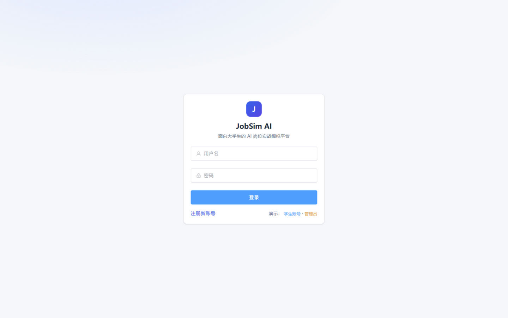
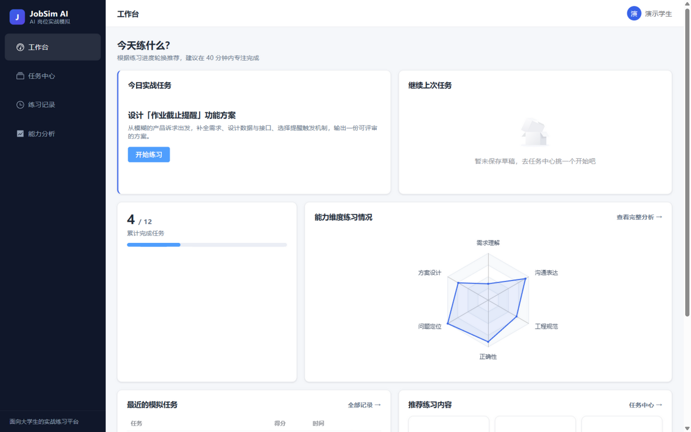
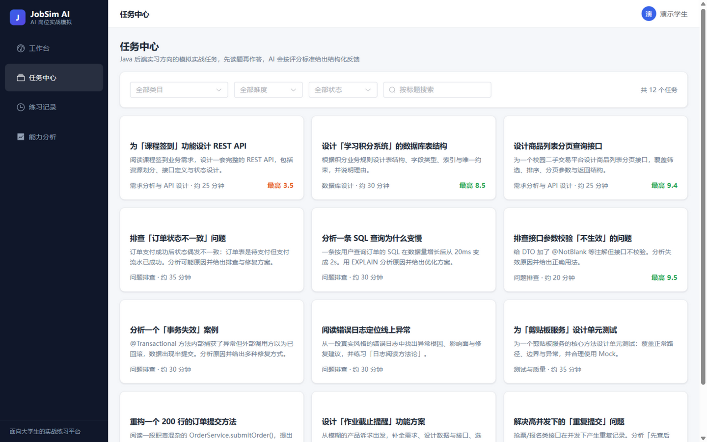
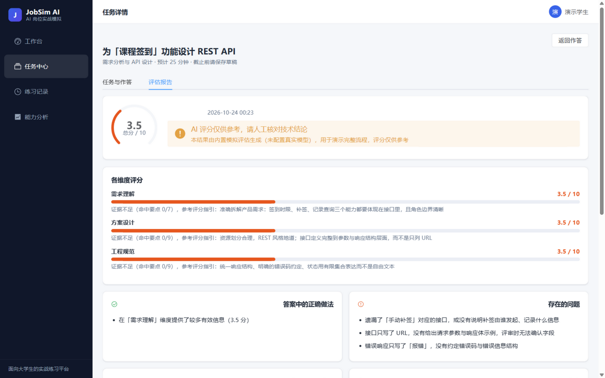
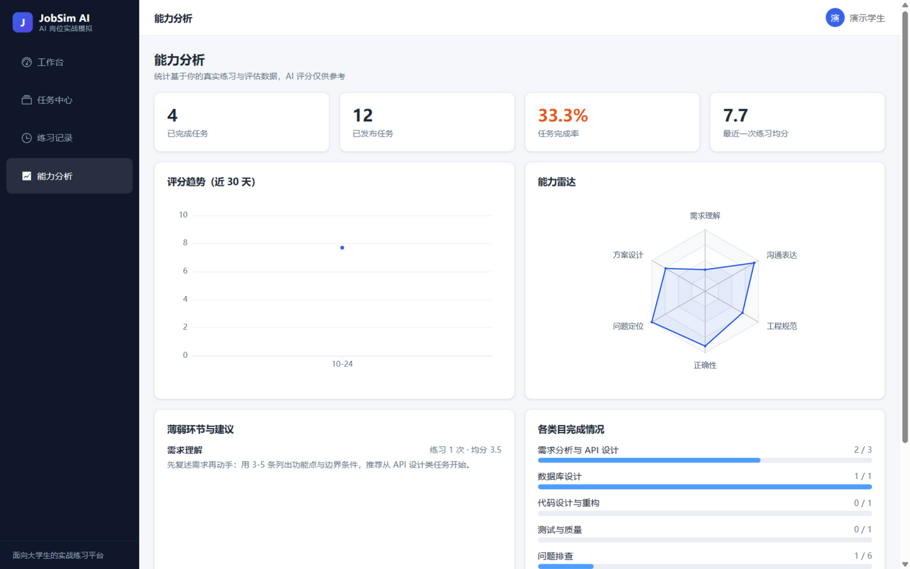
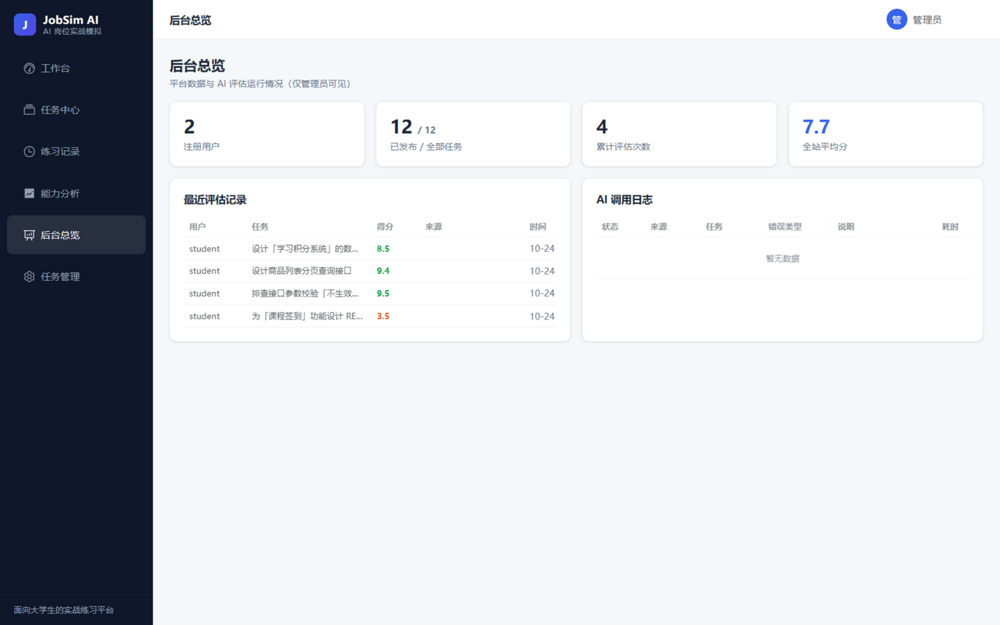
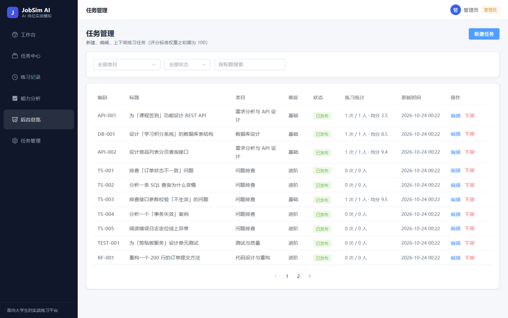
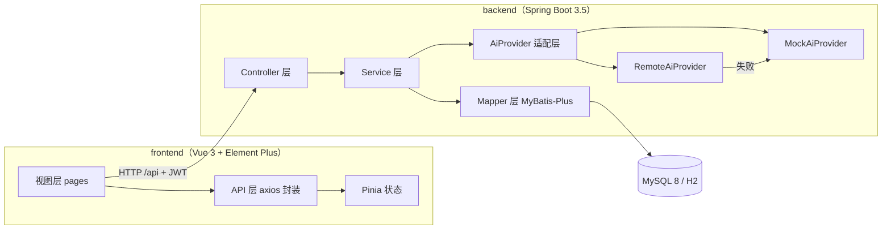
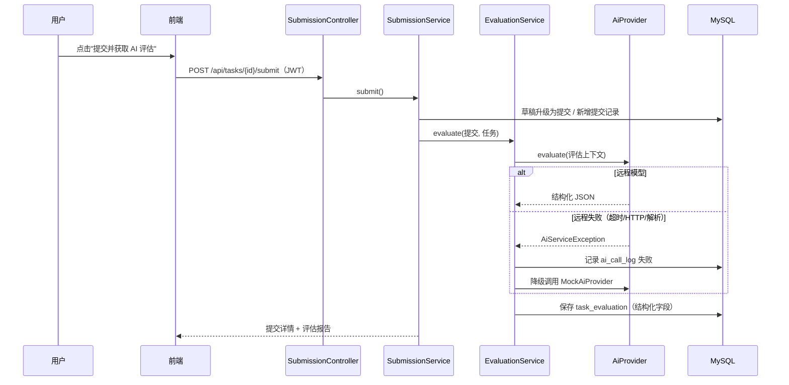

# OfferDojo · 面向大学生的 AI 岗位实战模拟平台

[](https://github.com/Yangxbao/OfferDojo/actions/workflows/ci.yml)


一个帮助大学生提前熟悉真实工作场景的实战模拟平台：选择岗位模拟任务 → 提交解决方案 → AI 按预设评分标准给出**结构化评估**（分维度得分、正确做法、问题、边界情况、改进建议、技术追问、下一步任务推荐）→ 沉淀个人能力画像。**没有配置任何 AI API Key 时也能完整跑通全部流程**（内置模拟评估）。

> **English**: OfferDojo is a full-stack learning platform for college students: practice realistic Java backend job tasks, submit solutions, and get structured AI feedback (per-dimension scores, strengths, problems, edge cases, suggestions, follow-up questions). Works fully offline with a built-in mock evaluator; optionally connects to any OpenAI-compatible API.

---

## 目录

- [功能一览](#功能一览)
- [界面截图](#界面截图)
- [技术栈与实际版本](#技术栈与实际版本)
- [架构](#架构)
- [快速开始](#快速开始)
- [演示账号](#演示账号)
- [目录结构](#目录结构)
- [测试](#测试)
- [文档](#文档)
- [安全说明](#安全说明)
- [路线图](#路线图)
- [许可证](#许可证)

---

## 功能一览

| 模块 | 说明 |
| --- | --- |
| 工作台 | 今日实战任务（按日期轮换）、累计完成、能力雷达、最近练习、推荐内容、继续上次草稿，全部基于真实数据计算 |
| 任务中心 | 内置 **220 个**人工设计的 Java 后端模拟任务，13 个类目（Java 核心与并发 / Spring 与框架 / Redis 与缓存 / 消息队列 / 分布式与微服务 / 系统设计场景 / 网络与操作系统 / 工程素养 / API 设计 / 数据库 / 问题排查 / 测试 / 重构），四档难度（基础 43 / 进阶 116 / 挑战 52 / 企业实战 9），支持类目、难度、状态筛选与标题搜索；题库为 JSON 文件，扩充后重启即自动增量入库 |
| 学习路线图 | 10 个阶段的新手路径：从开发地基 → Java 语法 → 集合 → 网络 → Spring → 并发与 JVM → 数据库与缓存 → MQ 与分布式 → 系统设计 → 企业实战冲刺；每个阶段标注「先学什么知识、按顺序做哪些题、达成什么里程碑」，任务进度实时联动 |
| 八股复习区 | **125 道**高频面试知识题（14 个类目全覆盖），每题标注「考察版本适用性」（防版本滞后的差异化），覆盖 Java 核心、并发、JVM、Spring、MyBatis、MySQL、Redis、MQ、网络；每题包含一句话总结（快速背诵）+ 大白话解释 + 背诵要点 + 示例 + 常见追问，支持按类目/频率/关键词筛选 |
| 开源学习资源中心 | **18 条真实核验资源**（12 个社区仓库 + 6 个官方文档），100 分制六维质量分级（精选 3 / 推荐 8 / 普通 3 / 待评估 3 / 下架 1），实时 Star/Fork/推送时间；核验状态与使用权限分开建模（无许可证默认禁止复制与再分发）；三条方向路线（26 个学习节点）关联资源与实战任务；个人学习计划与进度记录；多维筛选 + 6 种后端排序；管理员可质量评审/重新核验/上下架。详见 [docs/RESOURCES.md](docs/RESOURCES.md) |
| GitHub 热门项目榜 | 基于 GitHub 官方 Search API 的真实榜单（8 个技术方向），Star/Fork/创建/推送时间全为 API 返回值；匿名可用（无 Token 60 次/时）；错误分类处理（401/403/429/超时/连接失败）+ 排序口径明示 + 不伪造 Star 增量 |
| 项目广场 | 用户项目投稿（草稿→提交审核→发布状态机），Star/Fork 由服务端经 GitHub API 回填**无法伪造**，URL 白名单防注入，归属校验隔离，未审核不进公共展示区 |
| 社区题库 | 面试题投稿共建：八股/面试复盘/项目实战/系统设计/排查五类，DRAFT→审核→发布状态机；**授权硬约束**（仅审核的内容不能公开发布）；匿名选择；来源标注（用户原创/复盘整理）|
| AI 任务评估 | 提交后按任务评分标准返回结构化结果：维度得分、正确做法、问题、遗漏的边界情况、改进建议、技术追问、下一步任务推荐；Mock / 远程双 Provider，远程失败自动降级并如实标注 |
| 练习记录 | 每次提交保留历史，可回看当时的答案与评估报告 |
| 能力分析 | 评分趋势（30 天）、能力雷达、薄弱环节与学习建议、分类目完成率（规则生成建议，不做绝对能力评价） |
| 后台管理 | 任务新建/编辑/上下架（评分标准可视化编辑）、练习统计、评估记录、AI 调用失败日志（仅管理员） |
| 账户 | 注册/登录（JWT + BCrypt）、USER/ADMIN 角色、越权访问拦截 |

## 界面截图

> 以下截图均为本仓库代码真实运行时的界面（后端 MySQL 模式 + 演示数据）。

| 登录 | 工作台 |
| --- | --- |
|  |  |

| 任务中心 | 任务详情 · AI 评估报告 |
| --- | --- |
|  |  |

| 能力分析 | 后台总览 |
| --- | --- |
|  |  |

| 后台任务管理 | |
| --- | --- |
|  | |

## 技术栈与实际版本

版本均在开发时通过 Maven Central / npm registry 核实存在，见 `backend/pom.xml` 与 `frontend/package.json`。

| 层 | 技术 | 版本 |
| --- | --- | --- |
| 语言 | Java | 21 |
| 框架 | Spring Boot（Web / Security / Validation / Actuator） | 3.5.16 |
| ORM | MyBatis-Plus（+ mybatis-plus-jsqlparser） | 3.5.17 |
| 数据库 | MySQL / H2（测试与零依赖演示） | MySQL 8 / H2 2.3.232 |
| 认证 | Spring Security + jjwt（JWT） | jjwt 0.12.6 |
| 接口文档 | springdoc-openapi（Swagger UI） | 2.8.17 |
| 构建 | Maven | 3.9.x |
| 前端 | Vue / Vite / TypeScript / Element Plus / Pinia / Vue Router / ECharts / axios | 3.5 / 7.3 / 5.8 / 2.14 / 3.x / 4.x / 5.6 / 1.x |
| 测试 | JUnit 5 + Spring Boot Test（后端）、Vitest（前端） | — |
| CI | GitHub Actions（后端 + 前端双 job） | — |

**关于 AI 服务**：未直接引入 Spring AI 依赖，而是实现了一层同思想的 `AiProvider` 适配层（`service/ai/`），原因：版本耦合更小、代码量小更适合初学者逐行理解；接口与 Spring AI 的 ChatClient 概念一致，后续替换成本低。远程实现兼容 OpenAI `/chat/completions` 协议。

## 架构



核心请求流程（提交任务 → AI 评估）：



更多：[docs/ARCHITECTURE.md](docs/ARCHITECTURE.md) · [docs/DATABASE.md](docs/DATABASE.md) · [docs/API.md](docs/API.md)

## 快速开始

### 方式一：一键脚本（Windows，推荐第一次体验）

在项目根目录（`OfferDojo`）下：

```cmd
start-backend.cmd      :: 后端：自动探测 JDK 21，默认零依赖演示模式（H2 内嵌库，无需安装数据库）
start-frontend.cmd     :: 前端：首次运行自动 npm install 并启动开发服务器
```

打开 http://localhost:5173 ，用演示账号登录即可（见下表）。
后端默认跑在 8090；前端若 5173 被占用会自动换端口，以脚本窗口输出的地址为准。

手动等价命令（任何系统通用）：

```bash
# 后端（需要 JDK 21；JAVA_HOME 未指向 21 时会报 UnsupportedClassVersionError）
cd backend && mvn spring-boot:run -Dspring-boot.run.profiles=demo

# 前端
cd frontend && npm install && npm run dev
```

### 方式二：MySQL 模式（推荐日常开发）

```cmd
:: Windows：一条命令启动本机独立 MySQL（3307，不动已有服务）+ MySQL 模式后端
start-mysql.cmd         :: 首次使用需把脚本里的 MYSQL_BIN 改成你机器的 MySQL bin 目录
```

```bash
# 任意系统手动方式：先准备 MySQL 8（docker compose up -d 或已有实例），然后：
cp .env.example .env   # 修改数据库账号密码
cd backend && mvn spring-boot:run     # 默认 mysql profile；首次启动自动建表 + 写入演示数据
cd frontend && npm install && npm run dev
```

数据库连接、JWT 密钥、AI 配置均通过环境变量注入，参见 [.env.example](.env.example)。

- 后端接口：http://localhost:8090/api
- Swagger 文档：http://localhost:8090/swagger-ui.html
- 健康检查：http://localhost:8090/actuator/health

> 说明：默认端口是 **8090**（8080 在很多开发机上已被占用）。若 5173 端口被占，Vite 会自动使用 5174。启动失败请先看 [docs/TROUBLESHOOTING.md](docs/TROUBLESHOOTING.md)。

## 演示账号

| 角色 | 用户名 | 密码 | 能做什么 |
| --- | --- | --- | --- |
| 学生 | `student` | `student123` | 浏览任务、保存草稿、提交并查看 AI 评估、能力分析 |
| 管理员 | `admin` | `admin123` | 学生全部能力 + 后台任务管理与统计 |

> 演示账号在首次启动时自动写入（用户表为空时）；220 个内置任务与 125 道八股题按「编码已存在则跳过」的方式**增量写入**——已初始化过的库重启后会自动补齐题库新增的内容。生产环境请设置 `JOBSIM_SEED_ENABLED=false` 并修改密码。登录页有"一键填入演示账号"按钮。

## 目录结构

```
OfferDojo/
├── backend/                    # Spring Boot 后端
│   └── src/main/java/com/jobsim/
│       ├── common/             # 统一响应、异常、错误码
│       ├── config/             # 安全 / MyBatis-Plus / OpenAPI / AI 装配
│       ├── security/           # JWT 签发、过滤器、401/403 处理
│       ├── entity/             # 数据库实体
│       ├── mapper/             # MyBatis-Plus Mapper（含统计 SQL）
│       ├── dto/                # 请求/响应记录类
│       ├── service/            # 业务逻辑（含 ai/ 评估适配层）
│       ├── controller/         # REST 接口
│       └── bootstrap/          # 演示数据初始化
├── frontend/                   # Vue 3 前端
│   └── src/
│       ├── api/                # 接口封装与类型定义
│       ├── components/         # 评估报告、图表、卡片等
│       ├── views/              # 页面（含 admin/）
│       ├── stores/ router/ styles/ utils/
├── docs/                       # 架构、数据库、API、测试、学习指南等文档
├── screenshots/                # 真实运行截图
├── .github/workflows/ci.yml    # GitHub Actions
├── docker-compose.yml          # 可选：本地 MySQL
└── .env.example                # 环境变量模板（只有占位符）
```

## 测试

```bash
# 后端：18 个测试（单元 + 完整业务流程集成测试，H2 内存库，任何机器可直接运行）
cd backend && mvn test

# 前端：类型检查 + 6 个单元测试 + 构建
cd frontend && npm run type-check && npm test && npm run build
```

实际结果见 [docs/TESTING.md](docs/TESTING.md)。

## 文档

| 文档 | 内容 |
| --- | --- |
| [docs/ARCHITECTURE.md](docs/ARCHITECTURE.md) | 前后端架构、核心请求流程、AI 评估链路设计 |
| [docs/DATABASE.md](docs/DATABASE.md) | ER 图、表结构、索引与统计口径 |
| [docs/API.md](docs/API.md) | 重要接口、请求示例与响应格式 |
| [docs/TESTING.md](docs/TESTING.md) | 测试方法与实际运行结果 |
| [docs/LEARNING_GUIDE.md](docs/LEARNING_GUIDE.md) | 面向初学者：逐个目录/类讲解调用关系与推荐阅读顺序 |
| [docs/TROUBLESHOOTING.md](docs/TROUBLESHOOTING.md) | 启动失败排查手册（含本机实际遇到的坑） |
| [docs/ROADMAP.md](docs/ROADMAP.md) | 分阶段升级计划 |
| [docs/RESOURCES.md](docs/RESOURCES.md) | 开源学习资源中心的来源核验记录、许可证规则与管理员操作指南 |
| [docs/INTERVIEW_OUTLINE.md](docs/INTERVIEW_OUTLINE.md) | 校招面试项目讲解提纲 |

## 安全说明

**关于开发方式**：本项目由本人设计并主导开发，开发过程中使用 AI 辅助编码、测试与文档整理；全部功能均经本人实际运行验证（自动化测试与真实运行截图见上文），关键设计决策与踩坑记录见 docs 目录。

- 密码使用 BCrypt 单向哈希存储；JWT 密钥经环境变量注入，默认值仅供本地开发
- `.env`、构建产物、本地数据库文件均被 `.gitignore` 忽略；`.env.example` 只含占位符
- 用户只能访问自己的提交记录；`/api/admin/**` 双重校验（路径规则 + `@PreAuthorize`）
- AI 的 API Key 只出现在请求头，不写入日志与异常信息；`ai_call_log` 只记录错误类型与简述
- AI 评分明确标注"仅供参考，请人工核对技术结论"，评估结果记录来源（Mock / Remote / 降级）

## 路线图

见 [docs/ROADMAP.md](docs/ROADMAP.md)。简述：短期（远程 AI 提示词优化、评估缓存）→ 中期（多岗位方向、答题对比）→ 长期（分享卡片、错题本导出）。

## 许可证

[MIT](LICENSE)
