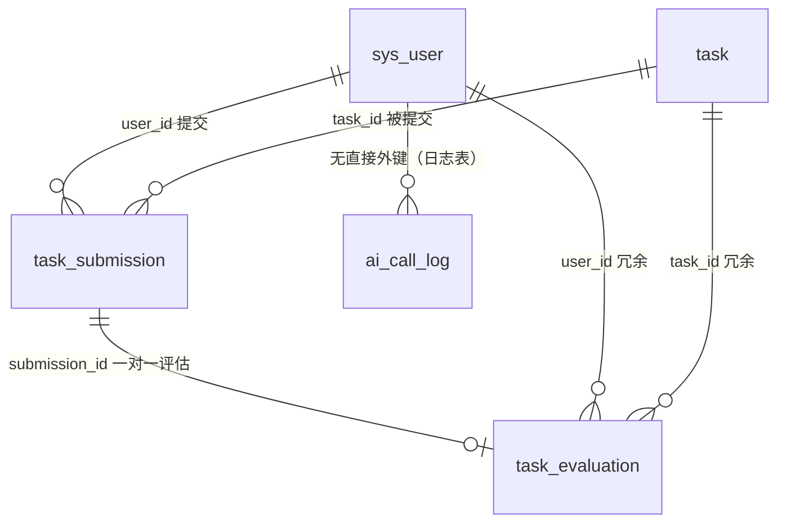

# 数据库设计

共 6 张表。建表脚本：`backend/src/main/resources/sql/schema-mysql.sql`（MySQL）与 `schema-h2.sql`（H2 兼容，结构一致），全部 `CREATE TABLE IF NOT EXISTS`，可重复执行。演示账号由 `DemoDataInitializer` 在用户表为空时写入；内置任务（214 个，题库文件 `demo/demo-tasks*.json`）与八股题库（75 个，`bagu/bagu-*.json`）按编码增量播种——编码已存在则跳过，题库扩充后重启即自动补齐。

## ER 图

## 表结构

### sys_user 用户表

| 字段 | 类型 | 说明 |
| --- | --- | --- |
| id | BIGINT PK AUTO | 主键 |
| username | VARCHAR(50) UNIQUE | 登录名（唯一约束） |
| password_hash | VARCHAR(100) | BCrypt 哈希，绝不存明文 |
| nickname | VARCHAR(50) | 昵称 |
| role | VARCHAR(20) | USER / ADMIN |
| created_at / updated_at | DATETIME | 自动填充 |

### task 模拟任务表

| 字段 | 类型 | 说明 |
| --- | --- | --- |
| id | BIGINT PK AUTO | 主键 |
| code | VARCHAR(64) UNIQUE | 业务编码，如 API-001 |
| title / summary / background | VARCHAR/TEXT | 标题、一句话简介、任务背景 |
| category | VARCHAR(32) | api-design / db-design / troubleshooting / testing / refactoring |
| difficulty | VARCHAR(16) | EASY / MEDIUM / HARD |
| tags | VARCHAR(255) | 逗号分隔标签 |
| estimated_minutes | INT | 预计用时 |
| requirements / constraint_items / deliverables / acceptance | TEXT | 需求/约束/交付物/验收，各存 JSON 字符串数组 |
| rubric_json | TEXT | 评分标准 [{dimension, weight, guidance}] |
| mock_hints_json | TEXT NULL | Mock 评估提示（关键词/亮点/常见问题等）；管理员新建任务可为空 |
| status | VARCHAR(16) | DRAFT / PUBLISHED / OFFLINE |
| sort_order | INT | 排序权重 |
| 索引 | | `uk_task_code` 唯一、`idx_task_category`、`idx_task_status` |

> 列名用 `constraint_items` 而不是 `constraints`：后者是 SQL 关键字，会让跨库脚本变脆弱。

### task_submission 提交表（含草稿）

| 字段 | 类型 | 说明 |
| --- | --- | --- |
| id | BIGINT PK AUTO | 主键 |
| user_id / task_id | BIGINT | 归属 |
| content | MEDIUMTEXT | 答案（Markdown 文本，最长 20000 字） |
| status | VARCHAR(16) | DRAFT 草稿 / EVALUATED 已提交 |
| 索引 | | `idx_sub_user_task(user_id, task_id)`、`idx_sub_user_status`、`idx_sub_task` |

每次重新提交插入新记录（历史可回溯）；草稿是覆盖式更新（同一任务同一人只保留最新草稿）。

### task_evaluation 评估结果表

| 字段 | 类型 | 说明 |
| --- | --- | --- |
| id | BIGINT PK AUTO | 主键 |
| submission_id | BIGINT UNIQUE | 一对一，一次提交一份评估 |
| user_id / task_id | BIGINT | **有意冗余**：按人/按任务统计不用多表 JOIN（读多写少场景的反范式取舍） |
| total_score | DECIMAL(4,1) | 加权总分 0.0-10.0（服务端按权重计算） |
| dimension_scores | TEXT | JSON：[{dimension, score, weight, comment}] |
| strengths / problems / edge_cases / suggestions / follow_ups / next_task_codes | TEXT | JSON 字符串数组 |
| provider | VARCHAR(20) | MOCK / REMOTE / MOCK_FALLBACK（降级如实标注） |
| model | VARCHAR(100) NULL | 远程模型名 |
| notice | VARCHAR(500) NULL | 提示（降级原因 / 免责说明） |
| 索引 | | `uk_eval_submission` 唯一、`idx_eval_user_created(user_id, created_at)`、`idx_eval_task` |

### ai_call_log AI 调用日志表

记录每次远程评估的结果与失败（provider/model/task_code/success/error_type/message/duration_ms），供后台查看失败记录。`message` 只含错误类别与简述，不含密钥与完整响应。

### interview_question 八股题库表

只读知识库：一句话总结（one_liner）、大白话解释（plain）、背诵要点（points JSON）、示例（example）、追问（follow_ups JSON），配合考察频率（frequency）与类目（category）筛选。内容由 `bagu/bagu-*.json` 增量播种，业务代码不做写操作。学习路线图（`demo/roadmap.json`）不落库，由后端解析 JSON 并关联任务表实时计算进度。

## 统计口径（与能力分析页对应）

| 指标 | 口径 | 实现位置 |
| --- | --- | --- |
| 累计完成任务 | `COUNT(DISTINCT task_id) FROM task_submission WHERE user_id=? AND status='EVALUATED'` | `SubmissionMapper#countDistinctCompletedTasks` |
| 能力雷达（6 维度） | 遍历该用户最近 100 条评估的 dimension_scores JSON，按维度取平均 | `AbilityCalculator.aggregate`（纯函数） |
| 评分趋势 | `task_evaluation` 按 `CAST(created_at AS DATE)` 分组取 AVG | `EvaluationMapper#selectTrend` |
| 薄弱环节 | 有练习记录且均值 < 7 的维度，升序取前 3 | `ProgressService` |
| 完成率 | 已完成去重任务数 / 已发布任务数，分类目对比 | `ProgressService` + 两类目聚合 SQL |
| 任务练习统计（后台） | `task_evaluation` 按 task_id 聚合次数/人数/均分 | `TaskMapper#selectTaskStats` |

所有统计都来自以上三张业务表的真实数据，没有写死的数字。

## 设计取舍说明

1. **JSON 字段 vs 拆表**：任务内容（需求/约束/评分标准）和评估结果是"整块读写、结构随产品演进"的数据，拆成子表会让管理和查询都变复杂；真正的查询维度（user_id/task_id/status/created_at/total_score）都是独立列并建了索引。
2. **MySQL JSON 类型**：为了同时兼容 H2（测试/演示）与 MySQL，JSON 内容用 TEXT 存储，解析在 Java 层完成（Jackson，忽略未知字段向前兼容）。
3. **冗余 user_id/task_id 到评估表**：评估是只写不改的数据，冗余换取统计 SQL 简单直观；如果未来要支持"评估可修改"，需要重新评估这个决定。
